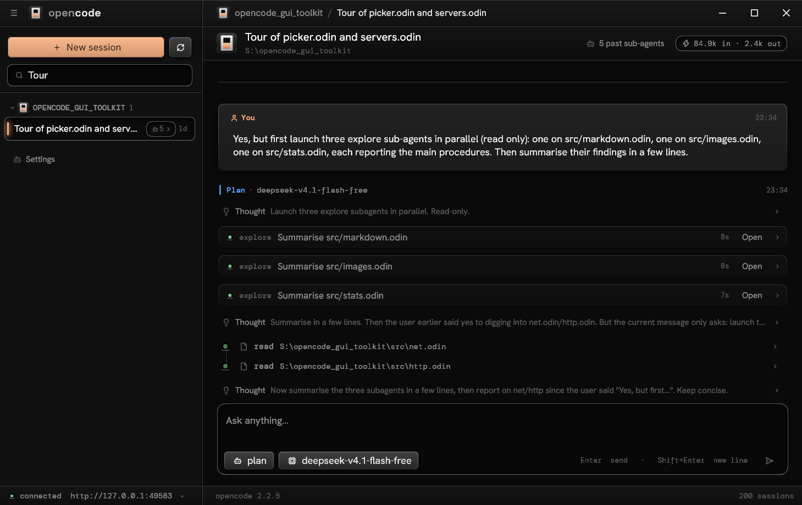
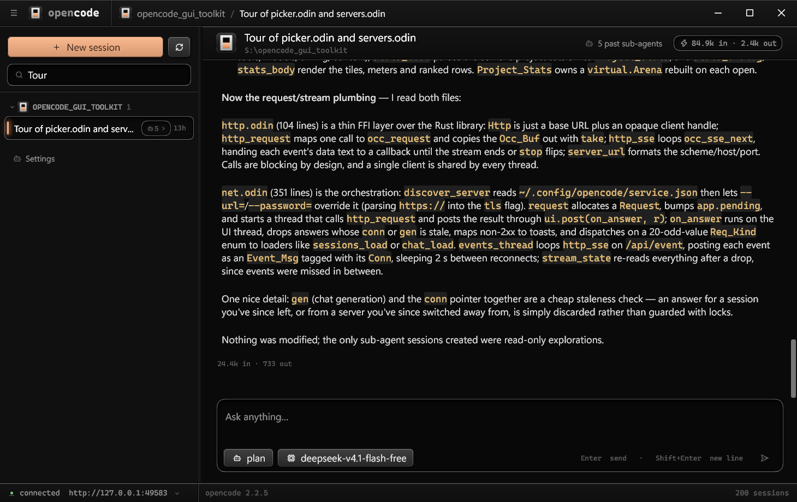
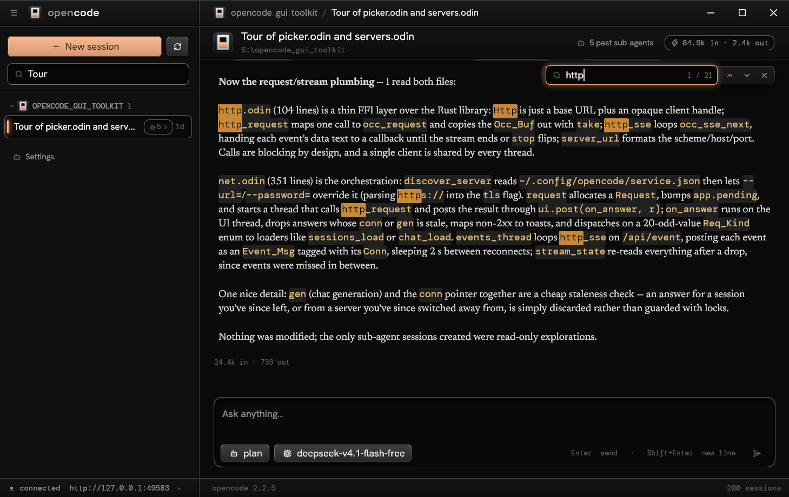
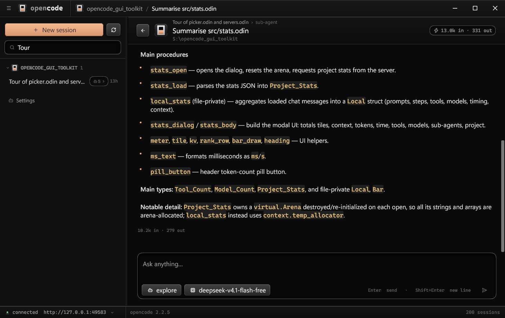
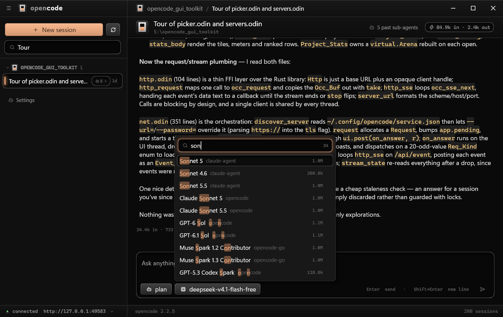
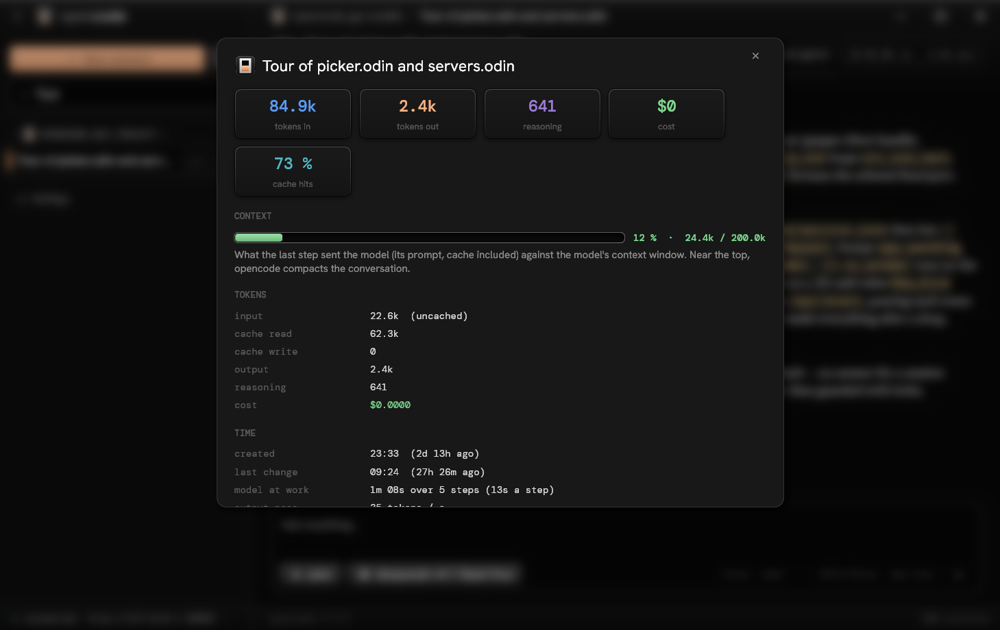
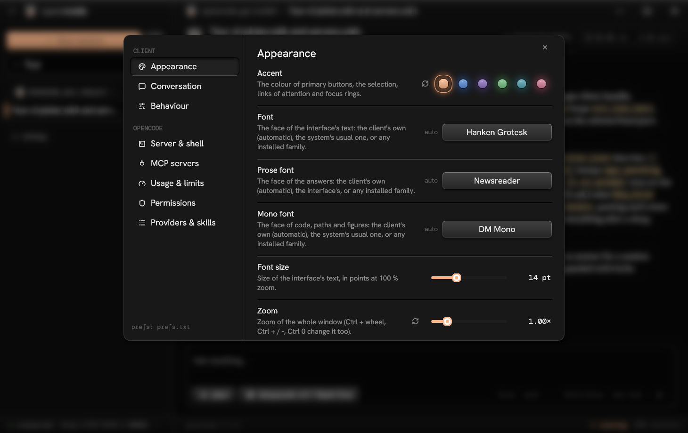
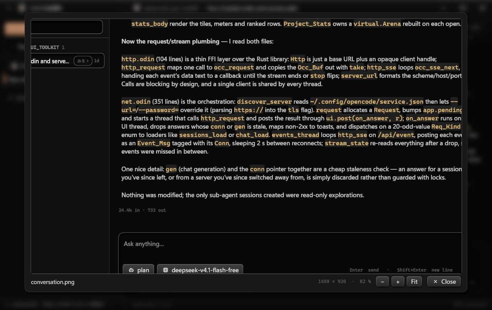
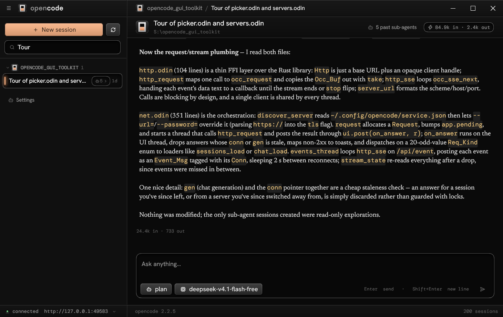

<h1 align="center">opencode native</h1>

<b>A native desktop client for the <a href="https://opencode.ai">opencode</a> v2 server, for Windows and Linux.</b>

One program, no runtime to install: [Odin](https://odin-lang.org) on [gui_toolkit](https://github.com/sachahjkl/gui_toolkit)
(Direct3D 11 and DirectWrite on Windows; Vulkan through wgpu-native, Fontations and HarfRust on Linux; a retained-state
immediate-mode UI), with a small Rust library for HTTP and images. It talks to the opencode server the desktop app already
runs on the machine (or any other), in opencode's dark palette with machined surfaces: bevelled and ridged buttons, sunken
wells, carved grooves, and lamps only where something is live.

    build.bat          ->  build\opencode-native.exe     (Windows)
    ./build.sh         ->  build/opencode-native         (Linux)

Prebuilt programs for Windows x64 and Linux x64 are attached to the [GitHub releases](https://github.com/sachahjkl/opencode_native/releases);
the [site](https://sachahjkl.github.io/opencode_native/) shows them.

## Screenshots

| | |
|---|---|
|  |  |
| **The conversation**: Markdown, code, tokens per answer | **Find** (Ctrl+F): every match lit, Enter / F3 to the next one |
|  |  |
| **A sub-agent's own conversation**: the breadcrumb, Back | **The model picker**: subsequence search ("son"), the matched letters lit |
|  |  |
| **Statistics** (click the token count): totals, context window, time, tools, models, the project | **Settings**: the client's preferences (fonts among them) and the server's pages |
|  |  |
| **The image viewer**: zoom where the pointer is, drag to move | **On Linux** (Wayland, Vulkan): the same program |

## What it does

- **A typeface of its own**, built into the program: Hanken Grotesk for the interface, Newsreader for the answers, DM Mono
  for code. Settings > Appearance goes back to the system's faces.
- **Sessions** grouped by project folder, with the project's logo; search; running ones lit; sub-agents nested under
  the session that launched them (the active ones counted and shown first).
- **The conversation, streamed live** from the server's event stream: Markdown (headings, lists, quotes, tables as
  aligned grids, code blocks with a copy button), the model's reasoning (folded, unfolded or hidden), the tool calls on a
  timeline (a carved rail through a run of calls, a lamp on the one running, a pip on the finished ones, their input and
  output in wells), tokens and cost. Switching sessions lands on the bottom at once. Scrolling up reads earlier messages by itself, a line
  showing the ones on their way if you get there first; Page Up and Page Down scroll it from anywhere, the arrows, Home and
  End when no field has the keyboard.
- **Images**: those attached to prompts and those tools hand back (screenshots, images read) as thumbnails, opened in
  a viewer that zooms where the pointer is and moves by a drag or the arrows, within limits; projects' logos in the sidebar, the title bar and the header. PNG, JPEG, WebP, GIF and BMP, decoded off the
  interface's thread.
- **Sub-agents**: a card for each launch (its agent, state, live activity, duration, model, tokens, cost, prompt and
  result), the result line where it came back, a strip of the running ones above the composer, a header menu of all of
  them; drill down into one and back (breadcrumb, Alt+Left).
- **The composer**: Enter or Ctrl+Enter to send (a setting), the agent and the model of the session in pickers searched
  as one types (subsequence matching, the matched letters lit, the keyboard or the wheel), Stop while it runs.
- **Several servers**: this computer's (found by itself), others added from the status bar's server menu (a name, an
  address, a password), `--url`; switch from the menu. Another computer's server is named in the title bar.
- **Find in the conversation** (Ctrl+F): every match of the text shown lit, the current one brighter and scrolled into
  view; Enter or F3 for the next, Shift+Enter or Shift+F3 for the previous, Escape to close.
- **Permission requests** answered in place (once, always, reject).
- **Statistics of a session** (its token count in the header, Ctrl+I): tokens in, out, reasoning, cache reads and
  writes, cost, cache hits, the context the last step filled against the model's window, time and pace, tool calls by
  tool (failures counted), models, its sub-agents, and the whole project's totals from the server.
- **Settings** (Ctrl+,): accent colour, the interface and code fonts (automatic, built in, or any installed one, in a searched picker), text size, zoom, density, rounding, animations, smooth scrolling, glow; how the conversation shows;
  the send key; sub-agents in the sidebar; notifications when a session finishes or asks. And what the server lets one see
  or change: its shell, its MCP servers (connect, disconnect), the usage limits and budgets of an OpenCode workspace, the
  saved permissions (revoke), providers, models, agents, skills, commands, the configuration files.
- **Desktop integration** without administrator rights: Setup installs the running copy for the user. On Windows: a
  Start menu shortcut with its AppUserModelID, a Settings > Apps entry, an uninstaller. On Linux: `~/.local/share`, an
  entry in the applications menu and its icon.

## The server

Without arguments the client uses this computer's opencode server: where the background service runs
(`~/.local/state/opencode/service.json`, what `opencode service status` prints), else what `~/.config/opencode/service.json`
asks for; with its password (Basic authentication as `opencode`). Until it answers, the client looks again every few seconds. Others: the status bar's server menu (saved in
`servers.txt` beside the preferences), or

    opencode-native --url=https://host[:port] --password=...

TLS is rustls, checked against the system's trust store.

## Command line

| | |
|---|---|
| `--url=...`, `--password=...` | another server |
| `--server=<name>` | a saved server at start |
| `--session=<id>` | open that session at start |
| `--search=<text>` | the sidebar's search, filled at start |
| `--stats` | open the session's statistics once it is loaded |
| `--install [--desktop]` | install this copy for the user (Windows: `%LOCALAPPDATA%\Programs\opencode-native`, Start menu, Settings > Apps; Linux: `~/.local/share/opencode-native`, the applications menu) |
| `--uninstall [--quiet]` | remove it |
| `--status` | exit code 0 installed, 2 needs repair, 1 not installed |
| `--setup` | open Setup at start |
| `--add-server` | open the dialog that adds a server at start |
| `--find=<text>` | open the find bar (Ctrl+F) with that text |
| `--scale=<factor>` | the interface's scale whatever the screen's (`1`: 100 %; screenshots) |
| `--size=<w>x<h>` | the window's size in pixels (screenshots) |
| `--image=<file>` | open the image viewer on a file |
| `--font-dir=<folder>` | try faces from files, nothing installed (`tools/font_proposals.mjs`) |
| `--pref name=value` | set a preference for the run (names in Settings, e.g. `appearance.accent=blue`) |
| `--settings[=n]` | open the settings at start (on page n) |
| `--frames=N` | N frames of a hidden window, then exit (a check that it runs) |

Preferences live in `%APPDATA%\opencode-native\prefs.txt` on Windows, `~/.config/opencode-native/prefs.txt` on Linux (only
what differs from the defaults), the servers in `servers.txt` beside them;
`OPENCODE_NATIVE_NO_SETUP=1` never offers Setup. `TOOLKIT_DEVTOOLS=<port>` lets a script drive the window over the Chrome
DevTools Protocol on 127.0.0.1, and Chrome's own DevTools inspect it (gui_toolkit's docs/devtools.md): for development only,
since a program on this computer can then type into a session.

## Building

    git clone --recursive https://github.com/sachahjkl/opencode_native
    cd opencode_native

**Windows**: the Odin compiler named in `odin.version` (`dev-2026-10`), MSVC (Visual Studio or its Build Tools:
`link.exe`, `rc.exe`) and Rust (stable, `x86_64-pc-windows-msvc`), then `build.bat`.

**Linux**: the same Odin, wgpu-native's static library in its vendor folder (`ext/gui_toolkit/tools/fetch_wgpu.sh`),
clang, fontconfig's headers and Rust (stable), then `./build.sh`. At run time: Vulkan, libxkbcommon, fontconfig, and
Wayland or X11.

Both build the Rust library first (`tools/build_native.*`, nothing when it is up to date; crates pinned by
`native/Cargo.lock`; on Linux it carries the toolkit's text backend), then the program. The toolkit is the submodule
`ext/gui_toolkit`; `GT=<folder>` builds against another copy, `OUT=<file>` writes the program elsewhere.

## Layout

| | |
|---|---|
| `src/main.odin` | window, loop, fonts, frame pacing (the toolkit's cadence model: a resize step is presented at once) |
| `src/net.odin`, `src/http.odin` | requests on worker threads, the event stream (`ui.post`) |
| `src/servers.odin` | the servers: discovery, the saved ones, connections, the menu and the dialog |
| `src/model.odin` | sessions, messages, parts and projects; events applied as they stream |
| `src/views.odin`, `src/markdown.odin` | sidebar, conversation, the tool timeline, composer, Markdown |
| `src/picker.odin` | the agent and model pickers |
| `src/subagents.odin` | sub-agent cards, results, navigation, the running strip, the sidebar tree |
| `src/images.odin` | image decoding (worker threads), the texture cache, thumbnails, the viewer, logos |
| `src/settings.odin` | preferences (`gt:config`) and the settings dialog, with the server's pages |
| `src/stats.odin` | the statistics of a session and of its project |
| `src/style.odin` | the palette, the icons, the machined surfaces |
| `src/setup.odin`, `src/desktop*.odin`, `src/os_*.odin` | version, Setup dialog, install / uninstall; what each system is asked |
| `native/occ_native` | the Rust library (C functions): ureq + rustls, image decoding (and the text backend on Linux) |
| `site/` | the GitHub Pages site |
| `tools/` | the Rust library's build, packaging, the site's changelog; `screenshots.mjs` retakes every picture of the README and the site (over the DevTools protocol, with `--linux` from a release's build in WSL) |
| `res/`, `assets/` | resources of the exe (icon, version, manifest), the logo, Lucide (`assets/fonts`, ISC) |

## License

MIT, see [LICENSE](LICENSE). Hanken Grotesk, Newsreader and DM Mono: SIL Open Font License, see `assets/fonts/*-LICENSE.txt`. Lucide's icons: ISC, see [assets/fonts/LUCIDE-LICENSE.txt](assets/fonts/LUCIDE-LICENSE.txt).
opencode is a project of its own ([opencode.ai](https://opencode.ai)); this client is not affiliated with it.
